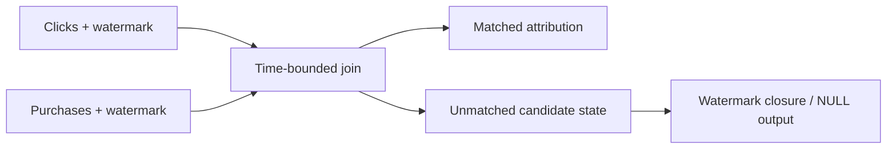

# 21 · Stream-stream joins and state lifetime

<ChapterMeta>

[06 · Joins and grain](/spark/06-joins-broadcast-skew), [19 · Event-time windows and watermarks](/streaming/19-windows-watermarks). [Lab 21](/labs/21-stream-stream-joins). Money: integer USD cents; lab timestamps: UTC.

</ChapterMeta>

## Why this matters

Hai unbounded streams cần giữ matching candidates ở cả hai phía. Không có time bounds và progress policy, unmatched state có thể tăng vô hạn.

## Scenario

Clicks stream C1=10:00, C2=10:05, C3=10:07; purchases P1 cho C1 lúc 10:10, P2 cho C2 lúc 10:12 đến phase sau. Khi nào được tuyên bố C3 không có purchase và emit NULL?

## Learner reasoning

Chưa match hiện tại không có nghĩa không bao giờ match. Cần business time-range contract và watermark ở phía quyết định future eligibility. Wall-clock timeout không thay event-time proof, đặc biệt khi source idle.

## Mental model

Join state giữ rows có thể còn match future input. Time predicate purchase_time trong [click_time, click_time+20m] cho engine boundary; watermark giúp xác định candidates hết eligibility. Inner emit match; outer còn phải chờ đủ bằng chứng để emit unmatched NULL.



## Core concepts

| Join / policy | Spark 4.0.4 requirements |
|---|---|
| Inner stream-stream | Watermark/time constraints optional for execution; cần để bound state |
| Left outer | Right-side watermark + event-time constraint required; left WM giúp all-side cleanup |
| Right outer | Left-side watermark + event-time constraint required |
| Full outer | Watermark on at least one side + time constraint; both sides cho bounded cleanup |
| Left semi | Right watermark + time constraint required; left watermark helps cleanup |
| Stream-stream output | Append supported; update/complete không là generic join modes |

## Example data

Lab dùng both-side WM=10m, full click_id/user_id match và 20m time range. Sau P2 delayed delivery, cả hai streams nhận future control events lúc 11:00/11:01 để advance progress. C3 NULL chỉ được asserted sau observed closure, không sau fixed sleep.

## How it works

Local lab chọn leftOuter, native Delta append. Default multiple-watermark policy min tránh fast source kéo slow source quá xa; idle side có thể giữ global progress thấp. Engine applies watermark qua micro-batch boundaries, nên unmatched output có thể cần thêm batch. Both WM và finite range cho state cleanup; key predicate một mình không đủ.

## Databricks implementation

Executable scope: local OSS Spark 4.0.4 + Delta 4.0.1 qua [pinned runtime](/setup/local-spark), Linux Docker trên Windows host. Không là Databricks Runtime execution. AWS docs retrieved 2026-10-11 cho production guidance; runtime-specific feature phải kiểm trước dùng. Local query có explicit schema/checkpoint, typed event time và fully consumed foreachBatch output nếu dùng custom sink.

## Production failure

Join only user_id không time bound khiến state và fan-out tăng; một user nhiều clicks/purchases còn làm revenue multiply. Outer NULL emitted sớm theo processing timer bỏ delayed attribution; forced max global policy có thể drop slow-source rows.

## Debugging

Đọc progress.sources cho cả hai inputs, event-time watermark và join stateOperators rows/removals. Kiểm matching-key grain, purchase-to-click cardinality và time predicate. Query healthy nhưng NULL chưa có có thể đúng do progress chưa đóng window.

## BigQuery / Airflow mapping

Batch join có cả hai bounded relations; unmatched result có nghĩa tại snapshot/cutoff đó. Streaming outer cần future eligibility boundary. Warehouse scheduled attribution có thể dễ quản lý hơn nếu SLA theo giờ và source không có stable event-time contract.

## Code

Actual implementation: labs/streaming/experiments.py::lab21, common.py. Bounded collect chỉ dùng để inspect tiny fixture; production sink không collect unbounded output lên driver.

```python
joined = clicks.join(purchases, expr('''c.click_id = p.click_id AND c.user_id = p.user_id
 AND p.purchase_time >= c.click_time
 AND p.purchase_time <= c.click_time + INTERVAL 20 MINUTES'''), 'leftOuter')
```

```powershell
python scripts/run_streaming.py --lab 21
python scripts/test_streaming.py test_21
```

[Lab 21](/labs/21-stream-stream-joins) hướng dẫn đọc observed progress, target states và checkpoint inventory; [streaming evidence](/labs/streaming-evidence) giữ selected JSON và hashes.

## Common mistakes

Mọi streaming join cần both watermarks để compile; inner join optional WM nghĩa state tự bounded; left outer emit NULL ngay khi batch không match; timeframe tự bảo đảm business attribution uniqueness.

## Production notes

MUST KNOW cho streaming-heavy DE roles; syntax awareness chưa đủ. Fixture dùng one click per match key và one matching purchase để tách state lifetime khỏi grain issues. Production multi-touch attribution, duplicate purchases và 72h corrections vẫn cần explicit business rules và reconciliation.

## Interview checkpoint

1. C3 chưa match: vì sao chưa được emit NULL ngay?
2. Purchases idle nhưng clicks tiếp tục: global watermark có thể ra sao?
3. Inner join không WM chạy được; operational risk là gì?

## How to explain this in an interview

“Tôi chọn join key và time-range contract trước syntax. Hai inputs tạo state; watermark progress quyết định expiry và delayed outer NULL. Join match không tự là unique attribution hoặc exactly-once business revenue.”

## PASS criteria

PASS: Chứng minh initial match, delayed match, controlled unmatched NULL và state removals; giải thích idle-input limitation. NOT YET nếu chỉ kể thuật ngữ, query active hoặc command exit 0 mà chưa chứng minh target correctness và failure boundary.

## Official references

Verified 2026-10-11, OSS Spark 4.0.4 và current AWS Databricks docs; cloud/runtime scope ở implementation.

- [Spark streaming API, state, output and recovery](https://spark.apache.org/docs/4.0.4/streaming/apis-on-dataframes-and-datasets.html).
- [Databricks checkpoints](https://docs.databricks.com/aws/en/structured-streaming/checkpoints).
- [Databricks watermarks](https://docs.databricks.com/aws/en/structured-streaming/watermarks).
- [Databricks foreachBatch guarantees](https://docs.databricks.com/aws/en/structured-streaming/foreach).
- [Delta streaming sink and transactions](https://docs.delta.io/delta-streaming/).
