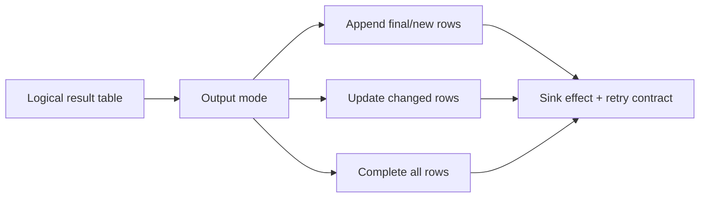

# 22 · Output modes and sink semantics

<ChapterMeta>

[17 · Stateless vs stateful streaming](/streaming/17-stateless-stateful), [19 · Event-time windows and watermarks](/streaming/19-windows-watermarks), [21 · Stream-stream joins and state lifetime](/streaming/21-stream-stream-joins). [Lab 22](/labs/22-output-modes-sinks). Money: integer USD cents; lab timestamps: UTC.

</ChapterMeta>

## Why this matters

Output mode chọn rows emit, sink contract chọn effect của những rows đó. Nhầm changed aggregate với revenue delta làm double count mà checkpoint không phát hiện.

## Scenario

Running U1 revenue từ 10 lên 15, U2 giữ 20. Downstream nên nhận changed U1=15, whole table U1=15/U2=20 hay chỉ finalized window? Nếu append U1=15 vào target đã có U1=10 thì dashboard đọc gì?

## Learner reasoning

Update aggregate là current value của changed key, không mặc nhiên là +5. Complete là snapshot cần replace/consume semantics. Append aggregate là finalized rows khi operator chứng minh không còn update theo watermark, khác append của stateless rows.

## Mental model

Result table là logical query result. Output mode chọn subset emit mỗi trigger; sink thực hiện append, replace, upsert hoặc external side effect. Exactly-once effect phụ thuộc cả hai contracts và retry behavior.



## Core concepts

| Mode | Emission | Consequence |
|---|---|---|
| Append | Rows mới; window aggregates chỉ khi finalized | Delay chịu watermark; finalized state có thể evict |
| Update | Rows changed kể từ trigger trước | Upsert absolute aggregate by result key |
| Complete | Entire aggregate result mỗi trigger | Full snapshot; aggregate history phải retained |

## Example data

Lab 22 compares update vs complete: first E1 U1=10/E2 U2=20, second E3 U1=5. Second update emits only U1=(15,2); complete emits U1=(15,2), U2=(20,1). Append window initial result rỗng, khi event progress advance mới emit window amount=30.

## How it works

### Operator and sink compatibility

| Choice | Validity / consumer obligation |
|---|---|
| Stateless rows + append | Emit new input-derived rows |
| Running aggregation + update/complete | Update cần keyed replace; complete cần snapshot semantics |
| Event-time aggregate + append | Requires suitable watermark/window finalization |
| Stream-stream join | Generic Spark support is append |
| Native Delta stream sink | Append hoặc complete theo documented Delta support |
| Delta aggregate update via foreachBatch | MERGE/upsert current values, fully consume batch |
| REST increment / non-idempotent DB append | Retry có thể tạo duplicate effect |

Database upsert cần stable result key, version/order policy và transaction boundary; gọi API không tự là transaction. Multi-target foreachBatch writes không là all-or-nothing transaction chung.

## Databricks implementation

Executable scope: local OSS Spark 4.0.4 + Delta 4.0.1 qua [pinned runtime](/setup/local-spark), Linux Docker trên Windows host. Không là Databricks Runtime execution. AWS docs retrieved 2026-10-11 cho production guidance; runtime-specific feature phải kiểm trước dùng. Local query có explicit schema/checkpoint, typed event time và fully consumed foreachBatch output nếu dùng custom sink.

## Production failure

Update U1=15 bị append sau U1=10 rồi SUM tạo 25. External API increment called hai lần do retry làm balance tăng đôi. Complete overwrite với concurrent writer có thể clobber changes ngoài snapshot ownership.

## Debugging

Kiểm emitted rows trong result.json, result key và sink history; phân biệt logical current value và additive delta. Đọc sink capabilities trước chọn outputMode. Test failure/retry trong Chapter 23, không dựa trên happy-path UI.

## BigQuery / Airflow mapping

BigQuery MERGE of current aggregates tương tự keyed replacement ở sink, còn INSERT+SUM cần additive delta contract. Airflow overwrite snapshot phù hợp complete nhưng phải có scope/concurrency policy.

## Code

Actual implementation: labs/streaming/experiments.py::lab22, common.py. Bounded collect chỉ dùng để inspect tiny fixture; production sink không collect unbounded output lên driver.

```python
query = writer(aggregate(source(spark, inputs)), checkpoint, 'update').foreachBatch(
    table_sink(target, 'update', ['user_id'])).start()
```

```powershell
python scripts/run_streaming.py --lab 22
python scripts/test_streaming.py test_22
```

[Lab 22](/labs/22-output-modes-sinks) hướng dẫn đọc observed progress, target states và checkpoint inventory; [streaming evidence](/labs/streaming-evidence) giữ selected JSON và hashes.

## Common mistakes

Update=increment; append luôn immediately available; complete automatically bounded by WM; bất kỳ sink nào cũng accept cả ba modes; Delta transactional mỗi write nghĩa mọi external effect cũng exactly-once.

## Production notes

Freshness và finality khác nhau: provisional update phục vụ 15-minute reporting, append-finalized window có thể chậm hơn do late tolerance. Current DBR có features khác OSS; xem [output-mode guidance](https://docs.databricks.com/aws/en/structured-streaming/output-mode) và [Delta streaming](https://docs.delta.io/delta-streaming/) trước triển khai.

## Interview checkpoint

1. U1=10 rồi update=15: sink nào cho correct total và vì sao?
2. Window WM=2h, append output có đạt provisional 15-minute freshness không?
3. Retry REST increment khác retry keyed upsert thế nào?

## How to explain this in an interview

“Output mode quyết định emission, không quyết định downstream effect. Tôi map changed values vào keyed upsert, complete vào owned snapshot và append windows vào finalization policy; sau đó test sink retry boundary.”

## PASS criteria

PASS: Đọc actual emissions cho ba modes và chọn sink contract bảo toàn aggregate qua retry. NOT YET nếu chỉ kể thuật ngữ, query active hoặc command exit 0 mà chưa chứng minh target correctness và failure boundary.

## Official references

Verified 2026-10-11, OSS Spark 4.0.4 và current AWS Databricks docs; cloud/runtime scope ở implementation.

- [Spark streaming API, state, output and recovery](https://spark.apache.org/docs/4.0.4/streaming/apis-on-dataframes-and-datasets.html).
- [Databricks checkpoints](https://docs.databricks.com/aws/en/structured-streaming/checkpoints).
- [Databricks watermarks](https://docs.databricks.com/aws/en/structured-streaming/watermarks).
- [Databricks foreachBatch guarantees](https://docs.databricks.com/aws/en/structured-streaming/foreach).
- [Delta streaming sink and transactions](https://docs.delta.io/delta-streaming/).
