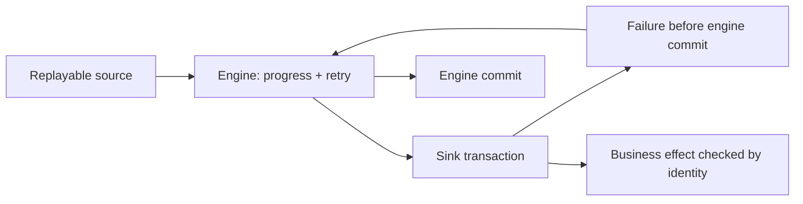

# 23 · Delivery semantics across source, engine and sink

<ChapterMeta>

[11 · Idempotency](/correctness/11-idempotency), [12 · MERGE](/correctness/12-merge-correctness), [18 · Checkpoints and restart boundaries](/streaming/18-checkpoints), [22 · Output modes and sink semantics](/streaming/22-output-modes-sinks). [Lab 23](/labs/23-delivery-semantics). Money: integer USD cents; lab timestamps: UTC.

</ChapterMeta>

## Why this matters

Guarantee phải tồn tại qua source → engine → sink boundary. Retry có thể đọc cùng input và chạy cùng computation nhiều lần mà business effect vẫn chỉ có một.

## Scenario

foreachBatch ghi E123=100 vào Delta, rồi exception xảy ra trước Spark engine commit. Restart same checkpoint sẽ retry batch đó. Append thường và transactional write sẽ tạo target khác nhau thế nào?

## Learner reasoning

Source có replay được không? Engine có durable progress/state không? Batch computation deterministic không? Sink dedup/transaction dùng identity nào? Crash sau sink commit trước engine commit có retry safely không? Trả lời từng boundary rồi mới đặt tên guarantee.

## Mental model

Exactly-once effect nghĩa retries/recovery vẫn tạo một logical business effect theo declared contract. Nó không có nghĩa physical delivery hay computation chỉ xảy ra một lần. Checkpoint commits không atomically bao trùm arbitrary remote API side effects.



## Core concepts

| Semantics | Concrete effect / trade-off |
|---|---|
| At-most-once | Không retry sau uncertain delivery; có thể mất purchase revenue |
| At-least-once | Retry allowed; append/increment có thể tạo duplicates |
| Exactly-once effect | Retry computation, sink still yields one effect under complete boundary contract |

## Example data

Lab 23 injects SIMULATED_AFTER_SINK_COMMIT sau actual Delta append. Failed checkpoint có offsets/N nhưng chưa commits/N. Same cp restart retries same observed batch ID. Unsafe append target 2×100; txnAppId + txnVersion=batchId giữ 1×100.

## How it works

### foreachBatch semantics

[Databricks foreachBatch](https://docs.databricks.com/aws/en/structured-streaming/foreach) documents at-least-once writes; batchId hỗ trợ dedup nhưng user code phải enforce end-to-end semantics. REST increment account balance bị gọi lại có thể tăng hai lần; stable idempotency key phải được receiver lưu/enforce atomically với effect.

[Delta idempotent writes](https://docs.delta.io/delta-streaming/#idempotent-table-writes-in-foreachbatch) dùng txnAppId + monotonically increasing txnVersion. Lab giữ app ID qua same-cp retries. New cp reset batch IDs: phải dùng new app ID để tránh false skip. New app ID tự nó không dedup business replay, nên historical replay vẫn cần target identity/version/reconciliation. Transaction-ID retention cũng phải bao phủ retry horizon.

## Databricks implementation

Executable scope: local OSS Spark 4.0.4 + Delta 4.0.1 qua [pinned runtime](/setup/local-spark), Linux Docker trên Windows host. Không là Databricks Runtime execution. AWS docs retrieved 2026-10-11 cho production guidance; runtime-specific feature phải kiểm trước dùng. Local query có explicit schema/checkpoint, typed event time và fully consumed foreachBatch output nếu dùng custom sink.

## Production failure

Sink transaction durable nhưng engine commit thiếu là legitimate retry window. Exception không được swallow rồi return success. Checkpoint mới tái dùng old app ID/batch IDs có thể skip legitimate new rows; đổi app ID nhưng blindly append replay lại duplicate business events.

## Debugging

So failed batch IDs với callback attempts, Delta target state và checkpoint offset/commit inventory. Query ID giữ, run ID đổi. Failed progress có thể chưa có completed progress entry: dùng captured callback attempts và durable sink evidence thay fake numInputRows.

## BigQuery / Airflow mapping

Airflow task retry sau warehouse commit cũng có uncertain success window. Idempotent target key hoặc transaction registry phải thực hiện cùng effect. Spark retries không làm remote balance increments an toàn hơn batch retries.

## Code

Actual implementation: labs/streaming/experiments.py::lab23, common.py. Bounded collect chỉ dùng để inspect tiny fixture; production sink không collect unbounded output lên driver.

```python
batch_df.write.format('delta').mode('append').option(
    'txnAppId', checkpoint_generation_id).option('txnVersion', batch_id).save(str(target))
```

```powershell
python scripts/run_streaming.py --lab 23
python scripts/test_streaming.py test_23
```

[Lab 23](/labs/23-delivery-semantics) hướng dẫn đọc observed progress, target states và checkpoint inventory; [streaming evidence](/labs/streaming-evidence) giữ selected JSON và hashes.

## Common mistakes

Exactly-once=physical delivery once; Delta=format bảo vệ arbitrary foreachBatch writes; batchId globally unique across cp generations; catching exception rồi return means recovered; multi-sink writes share one atomic commit.

## Production notes

Lab chỉ prove một Delta table single-writer transaction boundary, retained file source và stable transformation. Không prove external REST, Kafka, cloud crash hoặc multi-table transaction. Fully consume stateful foreachBatch output; cache khi cần nhiều actions và unpersist trong finally. Native Delta streaming sink có checkpoint-aware transaction protocol riêng, khác plain DataFrameWriter append trong callback.

## Interview checkpoint

1. Sink commit có, engine commit thiếu: cần replay hay bỏ?
2. REST increment muốn exactly-once effect phải enforce gì ở receiver?
3. New cp reset batchId=0: old txnAppId gây risk gì? New app ID giải quyết business replay chưa?

## How to explain this in an interview

“Tôi đánh giá source replay, engine progress/retry và sink transaction cùng nhau. Exactly-once effect cho phép nhiều attempts. foreachBatch chỉ cho at-least-once writes; batch IDs cần enforced identity và đúng checkpoint-generation namespace.”

## PASS criteria

PASS: Chứng minh durable sink write trước failure, same batch retried, target unsafe/safe khác nhau và nêu guarantee boundaries. NOT YET nếu chỉ kể thuật ngữ, query active hoặc command exit 0 mà chưa chứng minh target correctness và failure boundary.

## Official references

Verified 2026-10-11, OSS Spark 4.0.4 và current AWS Databricks docs; cloud/runtime scope ở implementation.

- [Spark streaming API, state, output and recovery](https://spark.apache.org/docs/4.0.4/streaming/apis-on-dataframes-and-datasets.html).
- [Databricks checkpoints](https://docs.databricks.com/aws/en/structured-streaming/checkpoints).
- [Databricks watermarks](https://docs.databricks.com/aws/en/structured-streaming/watermarks).
- [Databricks foreachBatch guarantees](https://docs.databricks.com/aws/en/structured-streaming/foreach).
- [Delta streaming sink and transactions](https://docs.delta.io/delta-streaming/).
