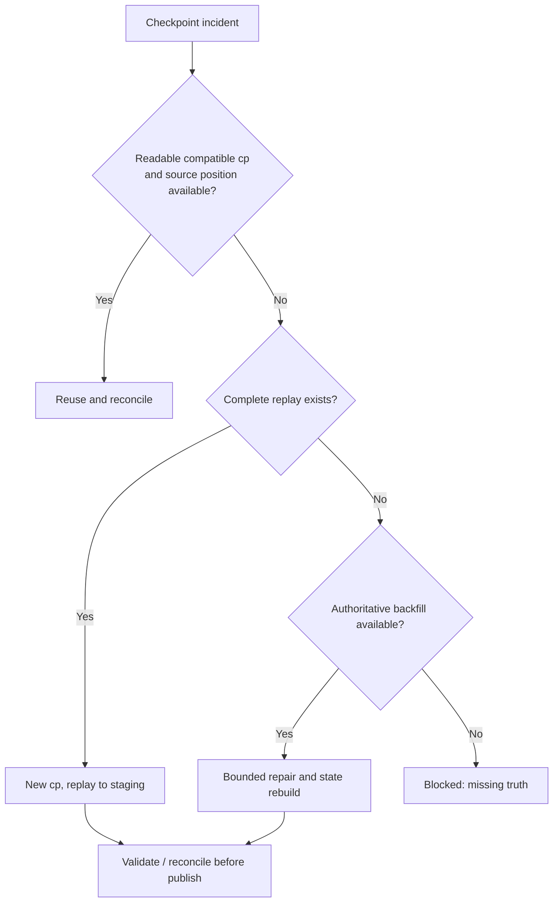

# 24 · Recovery and checkpoint failure

<ChapterMeta>

[15 · Backfill](/correctness/15-backfill-reconciliation), [18 · Checkpoints and restart boundaries](/streaming/18-checkpoints), [23 · Delivery semantics across source, engine and sink](/streaming/23-delivery-semantics). [Lab 24](/labs/24-recovery-runbook). Money: integer USD cents; lab timestamps: UTC.

</ChapterMeta>

## Why this matters

Recovery đúng phải phục hồi state, source position và target correctness. Làm query chạy trở lại chỉ là một phần của incident response.

## Scenario

Checkpoint corrupt, deleted hoặc không còn tương thích sau groupBy key change. Target đã có prior results; source retention có thể thiếu một phần history. Có được xóa cp rồi append tất cả lại không?

## Learner reasoning

Ghi last known target state, failed/last committed batch, source replay availability và source truth cutoff. Tách compatible continuation, replay to staging, bounded historical repair và unrecoverable truth gap. Mỗi lựa chọn cần reconciliation trước publish.

## Mental model

Một recovery boundary có ba phần: source position, state meaning và target effect. New checkpoint chỉ reset engine progress/state, không rollback target. Retained Bronze hoặc authoritative backfill giúp rebuild, nhưng source completeness phải được xác nhận.



## Core concepts

| Strategy | Khi nào hợp lý? |
|---|---|
| Reuse checkpoint | Readable, compatible, retained source positions còn available |
| New checkpoint + replay | Có complete retained input và explicit sink/rebuild policy |
| Bounded backfill | Historical truth có thể lấy lại theo affected scope |
| Full rebuild | Entire target/state cần recompute, full source snapshot đủ |
| Platform selective recovery | Chỉ khi platform feature support đúng operator/flow/version |
| Escalate missing truth | Không đủ replay hoặc authoritative backfill; chưa thể chứng minh correctness |

## Example data

Lab 24 chạy user aggregate E1 U1=100/E2 U2=50. Diagnostic checkpoint copy bị dùng với grouping user_id,platform; new E3 U1=20 làm actual state-schema failure. Original cp và serving target giữ nguyên. New cp replay retained files vào staging: U1=120/events2, U2=50/events1.

## How it works

### Checkpoint deletion scenario

Xóa cp hoặc đổi sang cp mới mất prior progress/state. File source có thể discovery retained files lại; other connectors start theo configured/source semantics. Existing target không reset theo. Native Delta query mới và custom transaction namespaces có thể khác old query; cần durable business idempotency hoặc staged rebuild/reconciliation.

### Recovery procedure

1. Stop affected writer; giữ diagnostic cp/target history copy, ghi code/config/source cutoff.
2. Kiểm readability và state/query compatibility, source positions còn replay được không.
3. Compatible: restart same cp, reconcile affected business keys/dates.
4. Incompatible/lost: chọn new cp và explicit source-start boundary; replay vào isolated staging hoặc idempotent latest-version target.
5. Retention gap: bounded authoritative backfill, reconstruct required state; full rebuild chỉ khi full truth available.
6. Validate keys, versions, dates/currencies, sums và gaps. Publish bounded scope theo Chapter 15, giữ live scope isolation.
7. Resume writers với generation/config mới và reconcile sau cutover.

Local executable exercise verifies steps 2, 4 and 6 plus serving-state isolation. Cloud corruption, permissions, source retention incident và production cutover cần operational implementation riêng.

## Databricks implementation

Executable scope: local OSS Spark 4.0.4 + Delta 4.0.1 qua [pinned runtime](/setup/local-spark), Linux Docker trên Windows host. Không là Databricks Runtime execution. AWS docs retrieved 2026-10-11 cho production guidance; runtime-specific feature phải kiểm trước dùng. Local query có explicit schema/checkpoint, typed event time và fully consumed foreachBatch output nếu dùng custom sink.

### Managed recovery ở mức awareness

[Lakeflow pipeline updates](https://docs.databricks.com/aws/en/ldp/updates) cho phép reset checkpoint của selected flows trong khi giữ table data. [Full refresh](https://docs.databricks.com/aws/en/ldp/full-refresh-st) của streaming table truncate data và reset checkpoints; nếu source không giữ đủ history, old rows có thể mất. Đây là platform controls khác nhau, không interchangeable. Local lab dùng isolated replay/rebuild; không gọi managed APIs hoặc thực hiện production refresh.

## Production failure

Thay group key nhưng reuse cp gây actual state-key/schema failure. Delete cp không sửa corrupt target; append full replay doubles revenue. Full refresh khi source thiếu retention có thể xóa phần historical truth còn ở target.

## Debugging

Runbook facts phải gồm checkpoint status, query version/config, last known target state, available input/cutoff, replay completeness và reconciliation output. Corruption do storage/permissions phải phân biệt incompatible state; không sửa raw cp files làm shortcut.

## BigQuery / Airflow mapping

Airflow clear tasks không reset warehouse state; similarly cp reset không undo Delta. Warehouse staging plus scoped publish/reconciliation vẫn hữu ích. Managed Lakeflow recovery/refresh là platform-specific control, không thay source-truth proof.

## Code

Actual implementation: labs/streaming/experiments.py::lab24, common.py. Bounded collect chỉ dùng để inspect tiny fixture; production sink không collect unbounded output lên driver.

```python
# New checkpoint, new state schema, retained input, isolated target.
query = writer(aggregate(source(spark, inputs), ('user_id', 'platform')),
               new_checkpoint, 'complete').foreachBatch(table_sink(staging)).start()
```

```powershell
python scripts/run_streaming.py --lab 24
python scripts/test_streaming.py test_24
```

[Lab 24](/labs/24-recovery-runbook) hướng dẫn đọc observed progress, target states và checkpoint inventory; [streaming evidence](/labs/streaming-evidence) giữ selected JSON và hashes.

## Common mistakes

Delete cp=clean correct pipeline; readable cp=compatible; full rebuild luôn possible; backfill không cần source cutoff; query healthy sau recovery=Gold correct.

## Production notes

Lab uses diagnostic cp copy; không delete original checkpoint và không process-kill container. Checkpoint corruption là conceptual incident branch, actual reproduced failure là state-schema incompatibility. Missing-truth case phải blocked, không bịa reconstructed history.

ROAS vẫn dùng 72h revision detection/reconciliation và bounded repair ngoài event-time state horizon. Sau chapter làm [Mid Gate: Streaming Correctness](/assessments/mid-gate-streaming-correctness).

## Interview checkpoint

1. Cp deleted, target append còn tồn tại, source replay đủ: phục hồi ra sao?
2. Replay retention thiếu yesterday nhưng authoritative export đủ: lựa chọn và proof nào?
3. Vì sao full rebuild nguy hiểm khi source history không complete?

## How to explain this in an interview

“Tôi recover state, source position và target correctness như một unit. Reuse cp chỉ khi compatible; nếu cần new cp tôi chọn replay/start và isolated repair, reconcile trước publish. Không đủ truth thì không tuyên bố recovery complete.”

## PASS criteria

PASS: Chọn strategy từ facts, reproduce incompatibility, prove staging exact state và preserve original serving state. NOT YET nếu chỉ kể thuật ngữ, query active hoặc command exit 0 mà chưa chứng minh target correctness và failure boundary.

## Official references

Verified 2026-10-11, OSS Spark 4.0.4 và current AWS Databricks docs; cloud/runtime scope ở implementation.

- [Spark streaming API, state, output and recovery](https://spark.apache.org/docs/4.0.4/streaming/apis-on-dataframes-and-datasets.html).
- [Databricks checkpoints](https://docs.databricks.com/aws/en/structured-streaming/checkpoints).
- [Databricks watermarks](https://docs.databricks.com/aws/en/structured-streaming/watermarks).
- [Databricks foreachBatch guarantees](https://docs.databricks.com/aws/en/structured-streaming/foreach).
- [Delta streaming sink and transactions](https://docs.delta.io/delta-streaming/).
