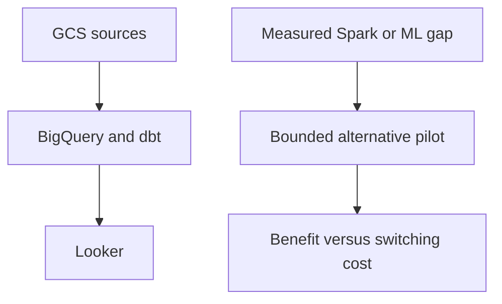

# 53 · Databricks versus BigQuery

<ChapterMeta>

[Prerequisite](/iceberg/52-managed-iceberg) · [Lab 53](/labs/53-databricks-vs-bigquery) · [evidence and boundaries](/labs/iceberg-evidence).

</ChapterMeta>

## Why this matters

Giữ BigQuery là quyết định hợp lệ khi SQL analytics đã đạt SLA/cost. Migration cần một vấn đề cụ thể và bằng chứng rằng kiến trúc thay thế giải quyết được nó.

## Scenario

GCS → BigQuery → dbt → Looker is stable. Three DEs, 90% SQL, hourly dashboard; CTO proposes Databricks because it supports Spark and Iceberg. No unmet SLA is identified.

## Learner reasoning

Trước khi đọc tiếp, ghi hypothesis và một observation có thể bác bỏ nó.

<details>
<summary>Compare your reasoning</summary>

Ask what fails today: latency, transformation complexity, ML integration, storage/control ownership or multi-engine consumers. A platform proposal must specify business benefit, alternatives and migration cost. Availability of Spark alone is not a requirement.

</details>

## Mental model



Đây là learning model; physical/API details cần source và runtime-specific evidence.

## Core concepts

| Requirement | Platform implication | Trade-off |
|---|---|---|
| SQL-heavy, low operations | BigQuery managed warehouse fits current team | Query/reservation costs still require management |
| Spark-heavy batch+stream+ML | Evaluate Databricks integrated workloads | New skills, IAM and operating model |
| Open storage/engines | Both offer Iceberg paths | Catalog, feature and write-boundary tests remain |
| Existing GCP stack meets SLA | Stay or improve current ELT first | Reevaluate when a concrete gap appears |

## Example data

Design scenario: 3 DEs, hourly fresh Gold, existing spend within approved budget. A separate proposed ML workload needs Python feature processing; prototype that workload independently before moving BI.

## How it works

BigQuery separates managed storage and analytical compute; native and open-table paths have distinct ownership. Databricks exposes SQL warehouses, Jobs, Spark pipelines and serverless options across a broader workload platform. Compare task coding, orchestration, IAM, troubleshooting and source cutoffs, not only query syntax.

## Databricks implementation

BigQuery managed Iceberg stores Parquet in customer GCS buckets, supports BigQuery DML and exports Iceberg v2 snapshots with auto refresh. Its external-engine path must follow managed-table write rules. Google Lakehouse REST-managed tables are a separate path with read/write and maintenance Preview options. See [ledger](/iceberg/current-platform-support).

Cloud execution: PENDING USER WORKSPACE. Không cấu hình credentials, tạo resources hoặc suy ra cloud readiness từ local evidence.

## Production failure

Migration duplicates transforms in dbt and notebooks. Different timezone/rounding or stale attribution cutoffs changes ROAS. The new platform meets job SUCCESS but Finance output disagrees.

## Debugging

| Symptom | Evidence | Decision |
|---|---|---|
| Migration lacks ROI | Current SLA, spend and incidents | Keep current platform |
| Wrong Gold after port | Exact grain, cutoffs and decimal/cents rules | Dual-run reconcile before cutover |
| Cost increase | Compute, maintenance, storage, egress, people | Compare total operating cost |

## BigQuery / Airflow mapping

Airflow can remain orchestrator for either platform. Keep DAG ownership and source interval contracts; do not add two competing schedulers without a reason.

## Code

[Lab 53](/labs/53-databricks-vs-bigquery) owns the exercise. Runtime commands and selected artifacts: [Iceberg evidence](/labs/iceberg-evidence).


```text
Requirement -> importance -> architecture implication
Alternative -> rejection condition -> acceptance evidence
Decision -> owner -> reversal trigger
```

## Common mistakes

Có Spark trong sản phẩm không tạo business requirement để migrate. Chuyển SQL chạy được chưa chứng minh timezone, rounding, corrections và output grain tương đương. Hai managed Iceberg paths có thể khác write authority.

## Production notes

When BigQuery is better: simple ELT, mostly SQL, small GCP-native team and stable SLA/cost. Databricks can be justified by a measured diverse workload gap. Sunk costs matter as avoidable switching/training costs, not as an obligation to keep a failing design.

## Interview checkpoint

1. Which unmet requirement would justify migration?
2. How would you test ROAS equivalence across SQL dialects?
3. How do managed BigQuery Iceberg and Google REST-managed tables differ?

## How to explain this in an interview

Tôi bắt đầu từ gap của workload hiện tại. Nếu BigQuery đã đạt SLA với SQL-heavy team, tôi giữ nó; tôi chỉ thêm Databricks khi pilot chứng minh lợi ích đủ lớn.

Use your scenario, assumptions and evidence; do not memorize the wording.

## PASS criteria

PASS: complete the lab, defend the layer boundaries and submit a falsifiable acceptance decision. NOT YET: unsupported execution claims, no rejected alternative, or unresolved correctness/governance risk.

## Official references

Verified 2026-10-11. Apache latest docs identify1.12.0; local Spark 4.0.4/Scala 2.13, Iceberg formatv2. Databricks sources are AWS; Google is GCP; Snowflake/Fabric limitations depend on deployment and client.

- [bigquery](https://docs.cloud.google.com/bigquery/docs/introduction).
- [bqIceberg](https://docs.cloud.google.com/bigquery/docs/biglake-iceberg-tables-in-bigquery).
- [googleLakehouse](https://docs.cloud.google.com/lakehouse/docs/manage-tables).
- [databricks](https://docs.databricks.com/aws/en/iceberg/).
