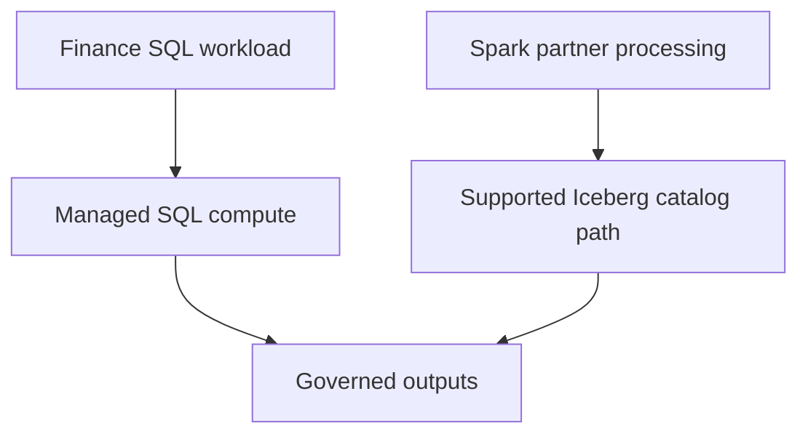

# 54 · Databricks versus Snowflake

<ChapterMeta>

[Prerequisite](/system-design/53-databricks-vs-bigquery) · [Lab 54](/labs/54-databricks-vs-snowflake) · [evidence and boundaries](/labs/iceberg-evidence).

</ChapterMeta>

## Why this matters

Snowflake có warehouse và open-table/lakehouse architectures. Databricks cũng có managed SQL và serverless; compare control/compute ownership và workload needs thay vì stereotypes năm2021.

## Scenario

Finance runs governed SQL with isolated reporting compute on Snowflake. Engineering wants external Iceberg consumers and some Spark jobs. Does this require migrating all reporting to Databricks?

## Learner reasoning

Trước khi đọc tiếp, ghi hypothesis và một observation có thể bác bỏ nó.

<details>
<summary>Compare your reasoning</summary>

Keep integrated SQL governance when it meets requirements. Evaluate external-engine/catalog paths for the additional workload. Distinguish Snowflake as Iceberg catalog from Snowflake reading externally cataloged tables, then cost the integration and maintenance.

</details>

## Mental model



Đây là learning model; physical/API details cần source và runtime-specific evidence.

## Core concepts

| Boundary | Snowflake model | Decision implication |
|---|---|---|
| SQL compute | Virtual warehouses plus service/serverless features | Isolate workload and account for usage |
| Native storage | Snowflake managed | Different access/lifecycle from open tables |
| Managed Iceberg | Snowflake catalog, managed lifecycle | Customer external volume or Snowflake storage |
| External Iceberg | External catalog authority | Platform feature/maintenance differences |
| Horizon REST | External-engine access to supported managed tables | Identity, storage and supported operations |

## Example data

Scenario: Finance10 TB, monthly reporting, stable SQL team; two Spark transformation jobs need partner data. Start with governed Iceberg integration pilot rather than replacing Finance dashboards.

## How it works

Snowflake architecture separates database storage, compute and cloud services. Databricks integrates Spark/SQL/pipeline/ML workloads with UC, including managed Iceberg. Both need source ownership, concurrency, freshness and spend policies. A Python API in a platform is not proof that the team needs Spark.

## Databricks implementation

Current Snowflake docs support Iceberg v2/v3 and Horizon REST multi-engine read/write for supported managed tables. Storage may be customer-managed or Snowflake-managed. External-catalog tables have narrower feature/lifecycle boundaries. New Open Catalog customers are directed to Horizon; verify current access path instead of copying old Polaris service onboarding.

Cloud execution: PENDING USER WORKSPACE. Không cấu hình credentials, tạo resources hoặc suy ra cloud readiness từ local evidence.

## Production failure

Two engines write with mismatched feature/delete support; a catalog sync lags after schema change. Engineers bypass row governance using storage credentials.

## Debugging

| Symptom | Inspect | Action |
|---|---|---|
| Consumer mutation unsupported | Catalog type, version and engine support | Choose supported writer authority |
| Egress surprise | Storage and compute region/cloud | Co-locate or justify transfer |

## BigQuery / Airflow mapping

BigQuery and Snowflake SQL workload similarity helps team skill assessment, but reservations/warehouses, IAM and open-table maintenance differ. Airflow ownership can remain stable.

## Code

[Lab 54](/labs/54-databricks-vs-snowflake) owns the exercise. Runtime commands and selected artifacts: [Iceberg evidence](/labs/iceberg-evidence).


```text
Requirement -> importance -> architecture implication
Alternative -> rejection condition -> acceptance evidence
Decision -> owner -> reversal trigger
```

## Common mistakes

Warehouse operating model không loại trừ open-table/lakehouse support. External-catalog reference không có cùng maintenance contract với Snowflake-managed table. Thiết kế phải chỉ rõ Spark thực thi ở đâu và dùng catalog path nào.

## Production notes

Cost model includes warehouses/services, storage, external-engine access, refresh, egress and staffing. No exact-price claim or universal cheap/fast winner is made. Snowflake can be an appropriate lakehouse platform.

## Interview checkpoint

1. Why is Snowflake-managed Iceberg different from an external-catalog reference?
2. When would Spark diversity outweigh an existing SQL estate?
3. How would you prevent governance bypass across engines?

## How to explain this in an interview

Tôi xem Snowflake là integrated SQL platform có open-table paths. Tôi kiểm tra catalog/storage authority và workload diversity trước khi cân nhắc Databricks hay một hybrid nhỏ.

Use your scenario, assumptions and evidence; do not memorize the wording.

## PASS criteria

PASS: complete the lab, defend the layer boundaries and submit a falsifiable acceptance decision. NOT YET: unsupported execution claims, no rejected alternative, or unresolved correctness/governance risk.

## Official references

Verified 2026-10-11. Apache latest docs identify1.12.0; local Spark 4.0.4/Scala 2.13, Iceberg formatv2. Databricks sources are AWS; Google is GCP; Snowflake/Fabric limitations depend on deployment and client.

- [snowflake](https://docs.snowflake.com/en/user-guide/tables-iceberg).
- [snowArchitecture](https://docs.snowflake.com/en/user-guide/intro-key-concepts).
- [ucRest](https://docs.databricks.com/aws/en/external-access/iceberg).
