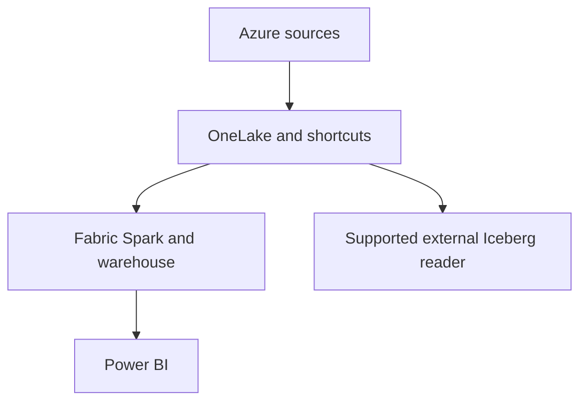

# 55 · Databricks versus Microsoft Fabric

<ChapterMeta>

[Prerequisite](/system-design/54-databricks-vs-snowflake) · [Lab 55](/labs/55-databricks-vs-fabric) · [evidence and boundaries](/labs/iceberg-evidence).

</ChapterMeta>

## Why this matters

Fabric có thể phù hợp nhất với tổ chức Microsoft/Power BI khi integrated analytics đáp ứng SLA. OneLake open-format capabilities cần đánh giá theo workload và conversion limits.

## Scenario

Azure enterprise already uses Power BI, Entra identities and Fabric capacity. A team proposes a second platform just to obtain Spark and Iceberg; current reports meet business needs.

## Learner reasoning

Trước khi đọc tiếp, ghi hypothesis và một observation có thể bác bỏ nó.

<details>
<summary>Compare your reasoning</summary>

Fabric offers OneLake, Lakehouse, Spark, pipelines, warehouse and Power BI integration. Databricks offers Spark/Delta/Iceberg, UC, Lakeflow and SQL across multiple clouds. Choose from existing operating model, feature requirements and governance tests.

</details>

## Mental model



Đây là learning model; physical/API details cần source và runtime-specific evidence.

## Core concepts

| Requirement | Fabric implication | Trade-off |
|---|---|---|
| Power BI-centered organization | Integrated serving and skills | Capacity contention and workload tuning |
| OneLake shared data | Shortcuts/metadata virtualization reduce copies | Region, identity and format limits |
| Broader multi-cloud platform | Evaluate Databricks workload estate | Additional platform integration/skills |
| Cross-engine Iceberg | Validate exact conversion path | Open data is not all-feature portability |

## Example data

Scenario: 80% business consumption via Power BI, Azure finance governance, hourly reports. Assumed enterprise constraints are design inputs, not platform benchmarks. Case D in Chapter 60 chooses Fabric conditionally.

## How it works

OneLake provides unified logical storage. Shortcuts reference data without requiring every dataset copy, but access/security/availability remain contracts. Fabric experiences consume different subsets of Delta features; a Spark read does not prove SQL endpoint or Direct Lake compatibility.

## Databricks implementation

Current OneLake metadata virtualization lets Iceberg be read as virtual Delta in Fabric and Delta be read through Iceberg metadata externally. It produces v2 Iceberg metadata, supports v2 sources and only selected v3 features. Equality deletes/multiple partition specs can fail conversion; some columns/features can be dropped with conversion-log evidence.

Cloud execution: PENDING USER WORKSPACE. Không cấu hình credentials, tạo resources hoặc suy ra cloud readiness từ local evidence.

## Production failure

A source evolves partition specs. Spark Iceberg query remains correct but OneLake conversion fails and keeps last converted state. A dropped v3 column changes report schema. Success in source engine does not mean fresh Fabric report.

## Debugging

| Symptom | Inspect | Action |
|---|---|---|
| Old virtual state | Conversion status/version and source snapshot | Hold publication, repair compatible path |
| Missing column | Conversion log and schema comparison | Reject lossy result for required columns |
| Capacity queue | Workload/capacity consumption | Rebalance or reevaluate platform |

## BigQuery / Airflow mapping

Power BI and Looker are serving consumers, not table formats. Airflow and Fabric pipelines have different identities/operations; migration must preserve intervals and failure policy.

## Code

[Lab 55](/labs/55-databricks-vs-fabric) owns the exercise. Runtime commands and selected artifacts: [Iceberg evidence](/labs/iceberg-evidence).


```text
Requirement -> importance -> architecture implication
Alternative -> rejection condition -> acceptance evidence
Decision -> owner -> reversal trigger
```

## Common mistakes

Các Fabric experiences không có cùng Delta feature coverage. OneLake metadata virtualization không dịch đầy đủ mọi Iceberg feature. Source query thành công không chứng minh conversion và report cutoff đã cập nhật.

## Production notes

Fabric is not inferior Databricks. Assess Microsoft consolidation value and required engine features. Current region/private-link/shortcut limitations belong to [support ledger](/iceberg/current-platform-support), not a permanent feature ranking.

## Interview checkpoint

1. Why can source Iceberg query pass while Fabric serves stale state?
2. What does shortcut access save and what does it leave to operate?
3. Which requirement justifies a second platform in an Azure enterprise?

## How to explain this in an interview

Tôi ưu tiên Fabric khi Power BI và Microsoft operating model phù hợp requirements. Với open-format consumers, tôi kiểm tra conversion logs, versions và schema thay vì giả định toàn bộ features portable.

Use your scenario, assumptions and evidence; do not memorize the wording.

## PASS criteria

PASS: complete the lab, defend the layer boundaries and submit a falsifiable acceptance decision. NOT YET: unsupported execution claims, no rejected alternative, or unresolved correctness/governance risk.

## Official references

Verified 2026-10-11. Apache latest docs identify1.12.0; local Spark 4.0.4/Scala 2.13, Iceberg formatv2. Databricks sources are AWS; Google is GCP; Snowflake/Fabric limitations depend on deployment and client.

- [fabric](https://learn.microsoft.com/en-us/fabric/onelake/onelake-overview).
- [fabricIceberg](https://learn.microsoft.com/en-us/fabric/onelake/onelake-iceberg-tables).
- [databricks](https://docs.databricks.com/aws/en/iceberg/).
