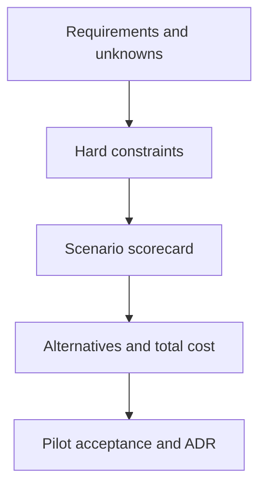

# 56 · Platform decision framework

<ChapterMeta>

[Prerequisite](/system-design/55-databricks-vs-fabric) · [Lab 56](/labs/56-decision-framework) · [evidence and boundaries](/labs/iceberg-evidence).

</ChapterMeta>

## Why this matters

Scorecards phải gắn importance với requirements của từng scenario. Hard constraints loại candidate trước; numeric score tổng quát không quyết định platform.

## Scenario

Two teams both process20 GB/day. One has3 DEs, 90% SQL on GCP, hourly stable BigQuery; the other has Spark-heavy features, batch+stream, ML and multiple governed consumers. Same volume leads to different decisions.

## Learner reasoning

Trước khi đọc tiếp, ghi hypothesis và một observation có thể bác bỏ nó.

<details>
<summary>Compare your reasoning</summary>

Clarify user-facing freshness, finalized correctness and recovery objectives first. Mark constraints, unknowns and weighted preferences. A preference cannot override an unmet legal/governance constraint. Reevaluate when requirements change.

</details>

## Mental model



Đây là learning model; physical/API details cần source và runtime-specific evidence.

## Core concepts

| Dimension | Evidence requested | Architecture implication |
|---|---|---|
| SLA / volume / velocity | p95 freshness, retained history, bursts | Ingest cadence, backfill and compute |
| Workload / SQL-Spark / batch-stream | Actual transformations and state | Engine and orchestration fit |
| ML-AI / cloud / skills | Near-term users, location, staffed expertise | Pilot scope and integration |
| Governance / interoperability | Access policy, required reader features | Catalog, IAM and format contracts |
| Operations / cost | On-call capacity and total budget | Managed versus self-operated ownership |
| Vendor strategy / existing investment | Procurement and avoidable switching costs | Consolidation and migration hurdle |

## Example data

Scorecard A: hourly correctness=mandatory; low operations=high; existing GCP/dbt skills=high; speculative ML=low. Conclusion stay BigQuery. Scorecard B: Spark feature jobs=mandatory; stream-state recovery=high; multi-engine open tables=high; integrated governance=high. Databricks is a candidate subject to supported-client and cost pilot.

## How it works

For each requirement write importance, implication, candidate evidence, missing acceptance and rejection condition. Estimate total cost as compute+maintenance+storage+egress+observability+people+migration+dual-run. Use sensitivity analysis for unknown workload growth, not fabricated vendor price totals.

## Databricks implementation

Cloud recommendations here are ARCHITECTURE EVIDENCE based on official platform models and stated assumptions. They do not prove managed performance, access-policy enforcement or production readiness.

Cloud execution: PENDING USER WORKSPACE. Không cấu hình credentials, tạo resources hoặc suy ra cloud readiness từ local evidence.

## Production failure

A weighted matrix gives speculative AI10 points and ignores hourly correctness or missing access enforcement. A team migrates because of sunk hype, or refuses needed change because of sunk cost.

## Debugging

| Symptom | Inspect | Fix |
|---|---|---|
| All options score alike | Scenario-specific importance and evidence | Replace vague ratings with acceptance tests |
| Winner violates hard constraint | Governance/SLA elimination rule | Reject before scoring preferences |

## BigQuery / Airflow mapping

An Airflow DAG is one operational choice inside the scorecard. Existing BigQuery/dbt/Looker skills are measurable switching costs, while an obsolete tool can still be rejected on concrete failure evidence.

## Code

[Lab 56](/labs/56-decision-framework) owns the exercise. Runtime commands and selected artifacts: [Iceberg evidence](/labs/iceberg-evidence).


```text
Requirement -> importance -> architecture implication
Alternative -> rejection condition -> acceptance evidence
Decision -> owner -> reversal trigger
```

## Common mistakes

Universal platform scores che khuất scenario importance. Weighted preferences không được bù một governance constraint chưa đạt. Speculative ML và volume trung bình không thay thế committed workload/peak/recovery requirements.

## Production notes

Architecture evidence includes requirements, alternatives, rejected designs, trade-offs, failure analysis and ADRs. Distinguish sourced capability from estimated recommendation. See [ADR-002](/adr/ADR-002-platform-choice) for a reversible decision example.

## Interview checkpoint

1. Which constraints eliminate an option before scoring?
2. How can changing team skills reverse a recommendation?
3. What evidence makes a speculative ML requirement actionable?

## How to explain this in an interview

Tôi không xếp hạng platform chung. Tôi gắn requirements với importance, hard constraints, operating cost và pilot acceptance; quyết định có điều kiện đảo ngược.

Use your scenario, assumptions and evidence; do not memorize the wording.

## PASS criteria

PASS: complete the lab, defend the layer boundaries and submit a falsifiable acceptance decision. NOT YET: unsupported execution claims, no rejected alternative, or unresolved correctness/governance risk.

## Official references

Verified 2026-10-11. Apache latest docs identify1.12.0; local Spark 4.0.4/Scala 2.13, Iceberg formatv2. Databricks sources are AWS; Google is GCP; Snowflake/Fabric limitations depend on deployment and client.

- [bigquery](https://docs.cloud.google.com/bigquery/docs/introduction).
- [snowArchitecture](https://docs.snowflake.com/en/user-guide/intro-key-concepts).
- [fabric](https://learn.microsoft.com/en-us/fabric/onelake/onelake-overview).
- [databricks](https://docs.databricks.com/aws/en/iceberg/).
