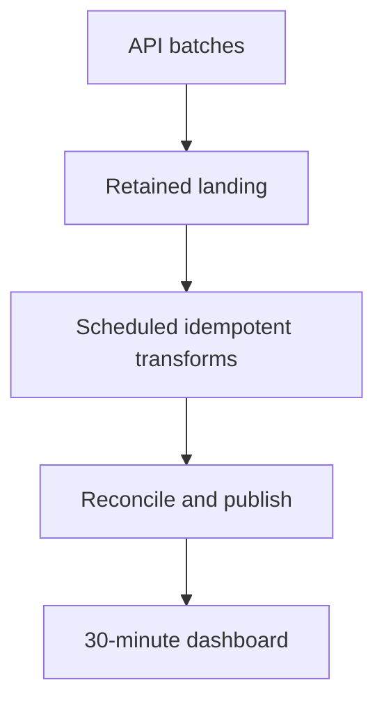

# 57 · When not to use Databricks

<ChapterMeta>

[Prerequisite](/system-design/56-decision-framework) · [Lab 57](/labs/57-when-not-databricks) · [evidence and boundaries](/labs/iceberg-evidence).

</ChapterMeta>

## Why this matters

Đừng thêm Databricks khi platform hiện tại giải quyết đúng nhu cầu với ít switching/operating cost hơn. Độ trưởng thành kiến trúc thể hiện ở khả năng loại complexity không tạo business value.

## Scenario

5 GB/day, dashboard every30 minutes. Proposed design: Kafka → Spark Streaming → Databricks → Iceberg → Kubernetes. One engineer owns it; sources are rate-limited APIs and no per-event response SLA exists.

## Learner reasoning

Trước khi đọc tiếp, ghi hypothesis và một observation có thể bác bỏ nó.

<details>
<summary>Compare your reasoning</summary>

30-minute freshness permits bounded scheduled ingestion if API completion, transform and serving fit the budget. Kafka adds source durability/decoupling only when those requirements exist. Kubernetes is not required to use managed Databricks or to query Iceberg. Start from the simplest design satisfying correctness and recovery.

</details>

## Mental model



Đây là learning model; physical/API details cần source và runtime-specific evidence.

## Core concepts

| Case | Lower-complexity candidate | Evidence before rejection |
|---|---|---|
| Simple sources→ELT→BI | Existing BigQuery/Snowflake SQL | Meets SLA and governance |
| Few GB/day, bounded transforms | Managed batch or simple single-node processing | Fits peaks and recovery time |
| Daily/hourly SLA | Scheduled transformations | Ingestion and transform latency budget |
| Small team | Existing integrated platform | Supported operations/on-call workload |
| Existing warehouse solves problem | Stay and improve known bottlenecks | Costs/incidents within agreed envelope |
| Microsoft/GCP/Snowflake consolidation | Approved enterprise platform | Required capability and portability contracts |

## Example data

Simplified proposal: API batch every10 minutes → retained object storage or warehouse landing → scheduled idempotent transform → serving table → BI. Assume p95 ingest≤5m, transform≤5m and BI refresh≤10m; these are acceptance targets, not measurements. Interval/retry keys, quarantine and reconciliation remain necessary.

## How it works

Define a30-minute end-to-end budget and measure source completion. Use scoped delivery/event keys, staged candidate and publication gate. Track input freshness separately from scheduler SUCCESS. If API cannot complete within budget, fix capture strategy rather than assuming streaming makes historical polling instantaneous.

## Databricks implementation

Databricks serverless can reduce infrastructure work but platform learning, identities, governance and workload ownership still cost effort. Tiny data alone is not a universal exclusion: existing Databricks estate or unusual transformation needs can justify it.

Cloud execution: PENDING USER WORKSPACE. Không cấu hình credentials, tạo resources hoặc suy ra cloud readiness từ local evidence.

## Production failure

The overengineered design needs stateful checkpoints, Kafka retention, multiple identities and Kubernetes on-call. A missed API cutoff still produces stale revenue. Complexity increases repair paths without achieving fresher source data.

## Debugging

| Symptom | Evidence | Simplification |
|---|---|---|
| Frequent ops incidents | Components and staffing | Consolidate supported managed batch path |
| Stale dashboard despite streaming | Source timestamps and BI refresh | Repair actual latency bottleneck |
| No migration return | Current outcome vs proposal cost | Keep warehouse |

## BigQuery / Airflow mapping

A GCP-native BigQuery/dbt/Looker stack is a valid complete architecture. Airflow can stay if already operated; for a tiny team an existing managed scheduler may be enough.

## Code

[Lab 57](/labs/57-when-not-databricks) owns the exercise. Runtime commands and selected artifacts: [Iceberg evidence](/labs/iceberg-evidence).


```text
Requirement -> importance -> architecture implication
Alternative -> rejection condition -> acceptance evidence
Decision -> owner -> reversal trigger
```

## Common mistakes

Tiny data không tự loại Databricks khi estate hoặc workload đã có căn cứ. Streaming không làm source API nhanh hơn. Simplification vẫn phải giữ retry/idempotency, retained truth và publication acceptance.

## Production notes

Reject the proposed design with a requirement argument, not vendor dislike. Name conditions that would justify reevaluation: measured stateful event SLA, Spark-only transformation, integrated ML demand or approved platform consolidation. Open format alone does not require a new platform.

## Interview checkpoint

1. Which components are necessary for the30-minute SLA?
2. What correctness contracts survive simplification?
3. What new requirement would justify Kafka or Databricks later?
4. Why does5 GB/day alone not decide the platform?

## How to explain this in an interview

Tôi giữ warehouse/batch khi nó đạt SLA và recovery với team hiện tại. Tôi loại complexity không có requirement, rồi ghi trigger rõ ràng để xem lại khi workload đổi.

Use your scenario, assumptions and evidence; do not memorize the wording.

## PASS criteria

PASS: complete the lab, defend the layer boundaries and submit a falsifiable acceptance decision. NOT YET: unsupported execution claims, no rejected alternative, or unresolved correctness/governance risk.

## Official references

Verified 2026-10-11. Apache latest docs identify1.12.0; local Spark 4.0.4/Scala 2.13, Iceberg formatv2. Databricks sources are AWS; Google is GCP; Snowflake/Fabric limitations depend on deployment and client.

- [bigquery](https://docs.cloud.google.com/bigquery/docs/introduction).
- [snowArchitecture](https://docs.snowflake.com/en/user-guide/intro-key-concepts).
- [fabric](https://learn.microsoft.com/en-us/fabric/onelake/onelake-overview).
- [databricks](https://docs.databricks.com/aws/en/iceberg/).
