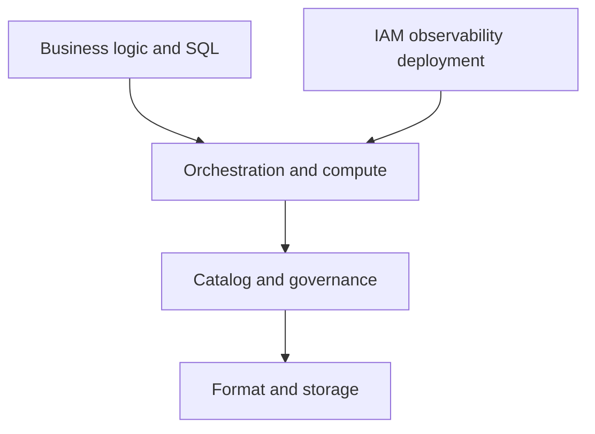

# 58 · Lock-in is multi-layered

<ChapterMeta>

[Prerequisite](/system-design/57-when-not-databricks) · [Lab 58](/labs/58-lock-in-layers) · [evidence and boundaries](/labs/iceberg-evidence).

</ChapterMeta>

## Why this matters

Open data format giảm một phần switching cost. Portability còn phụ thuộc business logic, catalog, policy, IAM và operational interfaces.

## Scenario

Data is Iceberg. The pipeline uses Unity Catalog grants, Lakeflow orchestration, Jobs parameters, SQL extensions and Databricks release/observability APIs. Procurement calls the whole application portable.

## Learner reasoning

Trước khi đọc tiếp, ghi hypothesis và một observation có thể bác bỏ nó.

<details>
<summary>Compare your reasoning</summary>

Distinguish readable files from portable behavior. An alternative engine must preserve types, mutations and business state; an alternative platform must also replace access enforcement, workflows, deployment, alerts and repair operations.

</details>

## Mental model



Đây là learning model; physical/API details cần source và runtime-specific evidence.

## Core concepts

| Layer | Exit artifact/test |
|---|---|
| Business logic / SQL dialect | Scoped contract and exact output reconciliation |
| Orchestration / compute APIs | Schedule, retry and backfill mapping |
| Catalog / table format / storage | Identifier, snapshot/features and path migration |
| Governance / IAM | Negative access tests and policy translation |
| Observability / deployment | Cutoffs, release identity, alerts and runbooks |

## Example data

Design migration packet includes grain, key/revision rules, source manifest, snapshot IDs, schema/spec/features, policy matrix, DAG semantics and rollback. No real export or catalog migration executed.

## How it works

Map coupling to replacement work and estimate effort. Test storage relocation carefully because metadata can contain absolute paths. Prefer a reviewed engine/catalog migration procedure over folder copying. Dual-run against the same source cutoff; validate access failures as well as happy-path reads.

## Databricks implementation

Databricks, BigQuery, Snowflake and Fabric each have control-plane coupling despite open-table access. Current REST catalog paths help interoperability without promising cross-platform policy portability.

Cloud execution: PENDING USER WORKSPACE. Không cấu hình credentials, tạo resources hoặc suy ra cloud readiness từ local evidence.

## Production failure

New reader loads Iceberg files but bypasses row masks via raw storage IAM. Numeric output matches, security contract fails. Pipeline rerun semantics duplicate data after orchestration port.

## Debugging

| Symptom | Inspect | Remedy |
|---|---|---|
| Readable but unsafe | Policy/IAM negative tests | Implement approved enforcement boundary |
| Exit estimate too low | Operational APIs and runbooks | Include platform behavior migration |

## BigQuery / Airflow mapping

dbt/Airflow can reduce some transformation/orchestration coupling but SQL macros, connections, authentication and observability may still bind the application to a platform.

## Code

[Lab 58](/labs/58-lock-in-layers) owns the exercise. Runtime commands and selected artifacts: [Iceberg evidence](/labs/iceberg-evidence).


```text
Requirement -> importance -> architecture implication
Alternative -> rejection condition -> acceptance evidence
Decision -> owner -> reversal trigger
```

## Common mistakes

Readable data không tự port policies, orchestration hoặc deployment. Folder copy có thể giữ absolute metadata paths. Output equivalence thiếu negative access tests chưa chứng minh migration an toàn.

## Production notes

Portability is a tested subset of behavior. Document accepted coupling and exit cost instead of claiming zero lock-in. Avoid maintaining duplicate implementations purely for hypothetical portability without a business requirement.

## Interview checkpoint

1. Which layers remain coupled when files are open?
2. Why is exact data reconciliation insufficient for an exit test?
3. Which portability work is justified now versus later?

## How to explain this in an interview

Tôi đánh giá lock-in theo layer và migration tests. Open files giúp data access; catalog, policies, retries và operations vẫn cần thay thế và kiểm chứng.

Use your scenario, assumptions and evidence; do not memorize the wording.

## PASS criteria

PASS: complete the lab, defend the layer boundaries and submit a falsifiable acceptance decision. NOT YET: unsupported execution claims, no rejected alternative, or unresolved correctness/governance risk.

## Official references

Verified 2026-10-11. Apache latest docs identify1.12.0; local Spark 4.0.4/Scala 2.13, Iceberg formatv2. Databricks sources are AWS; Google is GCP; Snowflake/Fabric limitations depend on deployment and client.

- [rest](https://iceberg.apache.org/rest-catalog-spec/).
- [ucRest](https://docs.databricks.com/aws/en/external-access/iceberg).
- [bqIceberg](https://docs.cloud.google.com/bigquery/docs/biglake-iceberg-tables-in-bigquery).
- [fabricIceberg](https://learn.microsoft.com/en-us/fabric/onelake/onelake-iceberg-tables).
