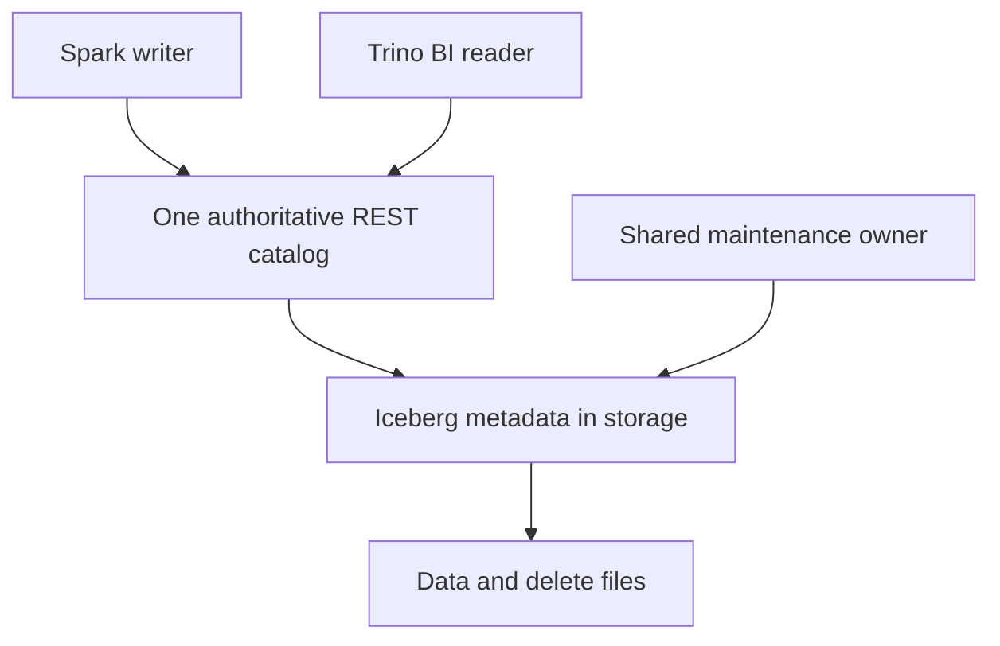

# 59 · Open lakehouse architecture

<ChapterMeta>

[Prerequisite](/system-design/58-lock-in-layers) · [Lab 59](/labs/59-open-lakehouse) · [evidence and boundaries](/labs/iceberg-evidence).

</ChapterMeta>

## Why this matters

Open lakehouse chọn storage, format, catalog và engines riêng. Team nhận thêm responsibility cho compatibility, lifecycle và observability khi đổi lấy engine choice.

## Scenario

Object storage holds Iceberg; Spark produces transformations; Trino serves BI; optional Flink handles streams. Two engines want to write the same table. Who commits, who cleans up, and who enforces finance access?

## Learner reasoning

Trước khi đọc tiếp, ghi hypothesis và một observation có thể bác bỏ nó.

<details>
<summary>Compare your reasoning</summary>

Choose one authoritative catalog and test required operations across actual client versions. Multiple engines can be a valid design, but raw storage sharing does not coordinate writes. Data lineage, retention and reader horizons need shared ownership.

</details>

## Mental model



Đây là learning model; physical/API details cần source và runtime-specific evidence.

## Core concepts

| Layer | Open architecture owner | Managed alternative |
|---|---|---|
| Storage | Cloud/IAM operator | Platform-managed lifecycle where supported |
| Iceberg format | Shared version/features contract | Platform-supported subset |
| REST catalog | Availability, auth, atomic commit service | Vendor catalog service |
| Compute engines | Versions, tasks and failure recovery | Integrated workload services |
| Maintenance / monitoring | Explicit responsible team | Integrated service with billing/limits |

## Example data

ARCHITECTURE EVIDENCE: Spark writer, Trino read-only BI, one REST catalog, object storage scoped credentials, named maintenance owner. Flink is an optional future consumer. Only Spark+Hadoop execution is measured locally; no Trino/Flink/REST server run.

## How it works

Read path: engine authenticates to REST catalog, loads metadata location/config, obtains supported scoped storage access, reads snapshot/manifest/data/delete files. Write path: engine writes candidates, sends commit requirements/updates, catalog atomically accepts or rejects; engine retries only after checking semantics.

## Databricks implementation

UC and Horizon can provide managed REST control planes; an open architecture need not self-host every component. Their feature, identity and maintenance contracts still apply. Google REST-managed options have distinct Preview boundaries.

Cloud execution: PENDING USER WORKSPACE. Không cấu hình credentials, tạo resources hoặc suy ra cloud readiness từ local evidence.

## Production failure

Two writers conflict after changing the same rows. Blindly retrying MERGE against stale business revisions corrupts results. Separate retention jobs race a long-running reader and remove required files.

## Debugging

| Failure | Required evidence | Ownership |
|---|---|---|
| Commit conflict | Expected state, retry result, business revision | Writer team |
| Reader feature incompatibility | Version/features and delete/spec coverage | Compatibility owner |
| Premature cleanup | Active horizons, snapshot retention | Maintenance owner |

## BigQuery / Airflow mapping

Managed warehouse integration trades fewer independently operated components for platform coupling. Airflow is an optional orchestration service in either model, not the catalog.

## Code

[Lab 59](/labs/59-open-lakehouse) owns the exercise. Runtime commands and selected artifacts: [Iceberg evidence](/labs/iceberg-evidence).


```text
Requirement -> importance -> architecture implication
Alternative -> rejection condition -> acceptance evidence
Decision -> owner -> reversal trigger
```

## Common mistakes

Engine choice không miễn phí integration/on-call. Two writers cần cùng commit authority và compatible operations. Self-operated catalog không tự tạo backups, credential vending, monitoring hoặc lifecycle policy.

## Production notes

Build vs buy: catalog availability, upgrades, credentials, maintenance, backups, audits and multi-engine failures require staffed ownership. More engine choices can increase total cost. Select the model that satisfies requirements within operational tolerance.

## Interview checkpoint

1. Trace every read/write boundary without collapsing layers.
2. What happens when two engines commit against the same old state?
3. Which duties move to the team when catalog is self-operated?

## How to explain this in an interview

Tôi chọn open lakehouse khi engine choice có giá trị và team chịu được integration burden. Tôi giữ một commit authority và kiểm tra client/features, IAM và maintenance theo cùng contract.

Use your scenario, assumptions and evidence; do not memorize the wording.

## PASS criteria

PASS: complete the lab, defend the layer boundaries and submit a falsifiable acceptance decision. NOT YET: unsupported execution claims, no rejected alternative, or unresolved correctness/governance risk.

## Official references

Verified 2026-10-11. Apache latest docs identify1.12.0; local Spark 4.0.4/Scala 2.13, Iceberg formatv2. Databricks sources are AWS; Google is GCP; Snowflake/Fabric limitations depend on deployment and client.

- [rest](https://iceberg.apache.org/rest-catalog-spec/).
- [spec](https://iceberg.apache.org/spec/).
- [ucRest](https://docs.databricks.com/aws/en/external-access/iceberg).
- [googleLakehouse](https://docs.cloud.google.com/lakehouse/docs/manage-tables).
- [snowflake](https://docs.snowflake.com/en/user-guide/tables-iceberg).
