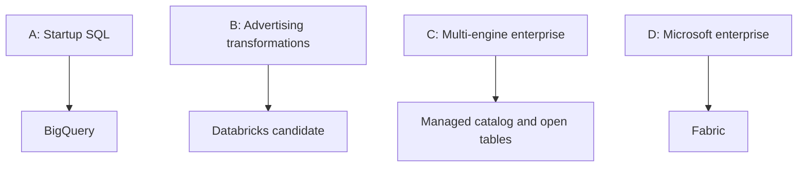

# 60 · System design case studies

<ChapterMeta>

[Prerequisite](/system-design/59-open-lakehouse) · [Lab 60](/labs/60-system-design-cases) · [evidence and boundaries](/labs/iceberg-evidence).

</ChapterMeta>

## Why this matters

Platform decision được đánh giá bằng requirements, alternatives và failure acceptance. Bốn designs dưới đây chọn khác nhau khi cloud, team và workload khác nhau.

## Scenario

Review four synthetic briefs: startup analytics, 15-minute advertising ROAS, enterprise multi-domain lakehouse, Microsoft-centered analytics. All request governance; only some need stateful streaming or multiple engines.

## Learner reasoning

Trước khi đọc tiếp, ghi hypothesis và một observation có thể bác bỏ nó.

<details>
<summary>Compare your reasoning</summary>

Treat each proposed design as conditional architecture judgment. Sourced product capabilities support feasibility, while scale, staffing and cost acceptance still need workload pilots. Do not pick the same platform by habit.

</details>

## Mental model



Đây là learning model; physical/API details cần source và runtime-specific evidence.

## Core concepts

| Case | Dominant constraint | Conditional choice |
|---|---|---|
| A Startup |3 DE, 90%SQL, GCP, hourly | BigQuery + dbt + Looker |
| B Advertising |15m provisional, 72h attribution corrections | Databricks candidate, source-cutoff publication |
| C Enterprise | Domains, Spark+SQL+ML, approved external engines | Managed Iceberg/REST catalog pilot |
| D Microsoft | Power BI/Entra/Azure and existing capacity | Fabric conditional on feature/access acceptance |

## Example data

Inputs are synthetic requirements. Case A5 GB/day; Case B20 GB/day plus late callbacks/cost API; Case C10 TB retained history and many domains; Case Dexisting Power BI estate. Data volume alone does not choose platform.

## How it works

### Case A: startup analytics

Requirements: hourly refresh, small SQL team, existing GCP/dbt/Looker, recover within one business day. Proposal: API batches → GCS retained landing → BigQuery → dbt → Looker. Choose native tables unless a concrete external-engine consumer requires open storage.

Alternative: Snowflake if procurement/skills favor it. Reject a new Kafka/Spark/Kubernetes stack because no event-level SLA or Spark-only workload is stated. Trade-off: GoogleSQL/IAM coupling remains; query scans and reservations need cost controls. Acceptance: source-cutoff freshness, exact grain/amount reconciliation, retry idempotency and recovery within target.

### Case B: advertising platform

Requirements: provisional15m ROAS, finance finalized next day, late attribution72h, hourly cost API. Proposal: retained callbacks and cost snapshots → scoped Bronze/Silver → candidate Gold → reconciliation/publication → BI. Databricks is a candidate for Spark-heavy processing and shared batch/stream recovery.

Alternative: BigQuery/dbt/Dataflow or bounded scheduled Jobs if they meet freshness and repair objectives. Reject labeling hourly stale cost as15m finalized ROAS; streaming alone cannot accelerate the source. Trade-off: provisional semantics, retention and state recovery remain difficult. Keep the accepted Delta model unless an actual consumer justifies native Iceberg or read exposure. Acceptance: revisions/conflicts, missing-cost rejection, replay after sink commit and exact cutoff reporting.

### Case C: enterprise lakehouse

Requirements: domain ownership, Spark/SQL/ML, finance governance, external readers and a staffed platform team. Proposal: object storage + managed Iceberg + one authoritative REST catalog, Spark transformations and approved query engines, shared feature/retention policy.

Alternative: UC managed Delta with Iceberg reads when external readers suffice; Snowflake/Horizon when SQL governance and the existing estate dominate. Reject self-hosted catalog merely to claim zero lock-in. Trade-off: native format changes can reduce reader compatibility; governance cannot rely on files being open. Acceptance: cross-engine snapshot/schema/delete tests, denied-access tests, commit-conflict tests and retained-snapshot recovery.

### Case D: Microsoft enterprise

Requirements: Azure/Entra/Power BI estate, approved Fabric capacity, hourly reports and integrated controls. Proposal: ingestion/pipelines → OneLake Lakehouse/Warehouse → governed Power BI; Spark only for transformations that need it.

Alternative: Azure Databricks when a measured workload gap outweighs second-platform integration. Reject migration just because both have Spark. Trade-off: capacity contention and OneLake conversion limitations; unsupported multi-spec/delete features need a compatible serving path. Acceptance: SQL endpoint/Direct Lake and Spark agree, conversion cutoff/schema is current, negative access tests pass and capacity meets SLA.


## Databricks implementation

The four platform designs remain design-only. [Ledger](/iceberg/current-platform-support) owns current cloud/version boundaries. Case B uses previously measured local correctness contracts as examples; it does not claim a deployed advertising pipeline.

Cloud execution: PENDING USER WORKSPACE. Không cấu hình credentials, tạo resources hoặc suy ra cloud readiness từ local evidence.

## Production failure

Executive preference overrides evidence and all cases migrate. A design mistakes20 GB/day for20 GB/min or treats speculative ML as a mandatory platform trigger. A required governance control is silently bypassed for interoperability.

## Debugging

| Review symptom | Inspect | Fix |
|---|---|---|
| Same choice for all cases | Constraints and rejected options | Reevaluate independently |
| Unfalsifiable decision | Missing SLA/cost/access acceptance | Add reversal conditions |

## BigQuery / Airflow mapping

Learner BigQuery/Airflow background is a valid starting asset. Preserve existing transforms and orchestration when justified; introduce a new engine only where the workload needs it.

## Code

[Lab 60](/labs/60-system-design-cases) owns the exercise. Runtime commands and selected artifacts: [Iceberg evidence](/labs/iceberg-evidence).


```text
Requirement -> importance -> architecture implication
Alternative -> rejection condition -> acceptance evidence
Decision -> owner -> reversal trigger
```

## Common mistakes

Một platform không mặc định phù hợp cả bốn briefs. Latency/cost targets là acceptance assumptions đến khi đo. Executive preference không thay thế requirements hoặc bỏ qua rejected alternatives.

## Production notes

Use [ADR-001](/adr/ADR-001-table-format) and [ADR-002](/adr/ADR-002-platform-choice) as worked decisions for specific scenarios. The final gate uses a distinct brief and accepts rejection of Databricks for defensible reasons.

## Interview checkpoint

1. Why does A choose BigQuery while B may choose Databricks?
2. Which Case C requirements justify native Iceberg versus Delta reads?
3. What would make Case D reject Fabric?
4. What evidence is necessary before any migration cutover?

## How to explain this in an interview

Tôi trình bày requirements, assumptions, alternatives và acceptance trước khi đề xuất platform. Tôi có thể chọn BigQuery hoặc Fabric khi phù hợp; Databricks phải giải quyết một gap có thật.

Use your scenario, assumptions and evidence; do not memorize the wording.

## PASS criteria

PASS: complete the lab, defend the layer boundaries and submit a falsifiable acceptance decision. NOT YET: unsupported execution claims, no rejected alternative, or unresolved correctness/governance risk.

## Official references

Verified 2026-10-11. Apache latest docs identify1.12.0; local Spark 4.0.4/Scala 2.13, Iceberg formatv2. Databricks sources are AWS; Google is GCP; Snowflake/Fabric limitations depend on deployment and client.

- [bigquery](https://docs.cloud.google.com/bigquery/docs/introduction).
- [bqIceberg](https://docs.cloud.google.com/bigquery/docs/biglake-iceberg-tables-in-bigquery).
- [snowflake](https://docs.snowflake.com/en/user-guide/tables-iceberg).
- [fabric](https://learn.microsoft.com/en-us/fabric/onelake/onelake-overview).
- [databricks](https://docs.databricks.com/aws/en/iceberg/).
